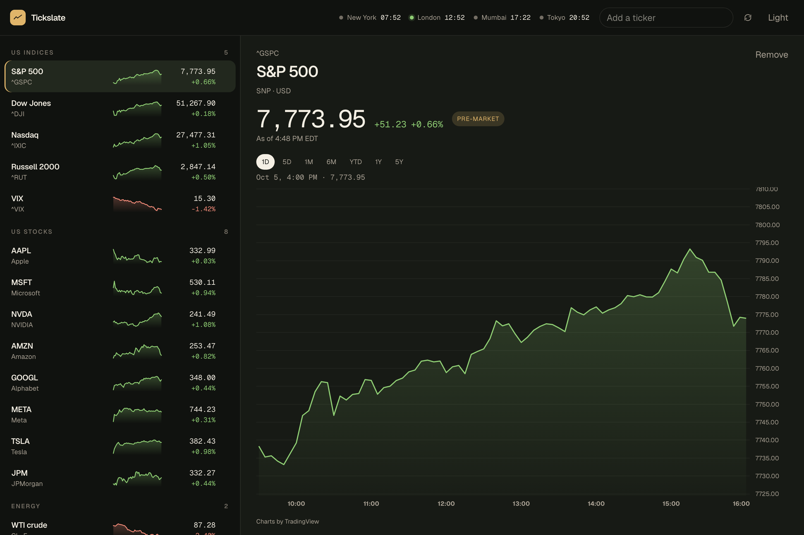

# Tickslate

A personal watchlist for the markets you actually check. US indices and stocks, crude oil, India, Asia and Europe, currencies, and crypto — live prices on the left, a simple area chart on the right.



Prices refresh in the background. The list you build stays in the browser.

## Install on a Mac

Tickslate needs macOS and Node.js 20 or newer. If Node is missing and Homebrew is installed, the installer fetches Node for you. The first run also needs a network connection to download dependencies.

```bash
git clone <repository-url>
cd tickslate
./install.sh
```

Then open [http://127.0.0.1:3000](http://127.0.0.1:3000). The server starts again when you log in.

Use another port if 3000 is taken:

```bash
PORT=4000 ./install.sh
```

Remove the installed copy, the login item, and the logs:

```bash
./uninstall.sh
```

Uninstall leaves this repository in place.

## Use it

- Rows are grouped: US indices, US stocks, energy, India, Asia & Europe, currencies, and crypto. Each row has the price, the day’s change, and a sparkline.
- Select a symbol to open its quote and area chart. Ranges are 1D, 5D, 1M, 6M, YTD, 1Y, and 5Y.
- Search adds a ticker. Press `/` to focus the search field. Arrow keys move through the list.
- Clocks for New York, London, Mumbai, and Tokyo sit in the header. A green dot means that regular session is open.
- A pill shows open, pre-market, post-market, or closed. Delayed quotes are labeled.
- Switch between dark and light from the header. The choice is remembered.

The default tape includes the S&P 500, Dow, Nasdaq, Russell 2000, and VIX; Apple, Microsoft, NVIDIA, Amazon, Alphabet, Meta, Tesla, and JPMorgan; WTI and Brent; Nifty 50, Sensex, and Nifty Bank; Nikkei, Hang Seng, Shanghai, Shenzhen, China A50, KOSPI, Taiwan, DAX, and FTSE 100; the US dollar index, EUR/USD, GBP/USD, USD/JPY, USD/INR, and USD/CNY; Bitcoin, Ethereum, and Solana.

Search also knows a few more names, such as Reliance, gold, and the CAC 40. Any other Yahoo symbol can be added by typing it.

## Develop

```bash
npm install
npm run dev
```

The dev server uses [http://127.0.0.1:3000](http://127.0.0.1:3000) as well. Stop the installed copy first, or start dev on another port with `npm run dev -- --port 3001`.

## Prices

Quotes and charts come from Yahoo Finance. Equity prices are often delayed. The one-day chart is the one that stays available. Longer ranges load when Yahoo is not rate-limiting the request.
